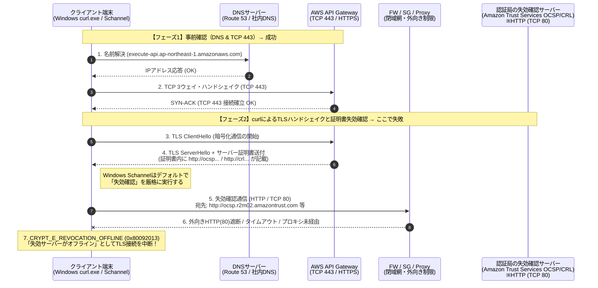
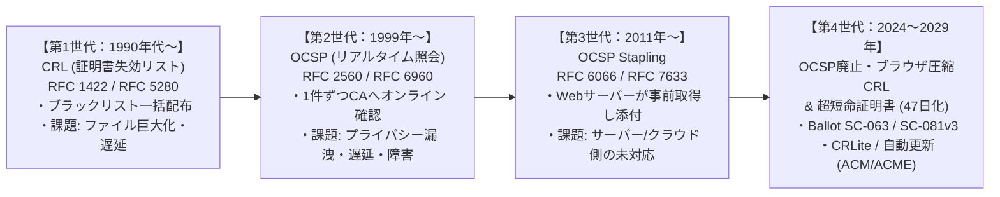

# API Gateway接続確認時の `curl`「失効サーバーオフライン (`CRYPT_E_REVOCATION_OFFLINE`)」完全対策・解説ガイド

## 1. エグゼクティブサマリー（結論と全体像）

AWS API Gateway（パブリックエンドポイント、カスタムドメイン、またはインターフェースVPCエンドポイント経由のプライベートAPI）に対して接続確認を行う際、**① DNS名前解決が成功し、② TCP 443ポートへの疎通確認（`Test-NetConnection` 等）も成功しているにもかかわらず、`curl` コマンドを実行した瞬間に「失効サーバーがオフライン (`CRYPT_E_REVOCATION_OFFLINE: 0x80092013`)」と表示されて失敗する事象**は、閉域網・社内プロキシ環境・セキュリティグループ制限環境で非常に多く発生する典型的なトラブルです。

### 発生しているエラーメッセージの代表例
```text
curl: (35) schannel: next InitializeSecurityContext failed: CRYPT_E_REVOCATION_OFFLINE (0x80092013)
- 失効サーバーがオフラインのため、失効の関数は失効を確認できませんでした。
(The revocation function was unable to check revocation because the revocation server was offline.)
```
*(※環境によっては関連エラーとして `CRYPT_E_NO_REVOCATION_CHECK (0x80092012)` が表示されることもあります)*

### 結論：何が起きているのか？
1. **API Gateway自体や認証局（Amazon Trust Services等）のサーバーが故障・停止しているわけではありません。**
2. **API Gatewayまでの通信経路（DNSおよびTCP 443）は正常に開通しています。**
3. エラーの直接原因は、**Windows標準の `curl.exe` が内部で使用しているSSL/TLSライブラリ「Schannel（Windows標準暗号化機構）」が、API Gatewayから受け取ったSSL/TLSサーバー証明書が「失効（無効化）されていないか」を確認するために、インターネット上の認証局（CA）の失効確認サーバー（OCSP / CRL）へ「HTTP（TCP 80番ポート）」で別通信を行おうとし、ファイアウォール・プロキシ・ルーティング制限によって遮断されたこと**にあります。



---

## 2. 小学生にもわかる！やさしい解説（「ひみつの基地」と「校長先生への確認電話」）

このエラーがなぜ起きるのか、**「ひみつの基地（API Gateway）へのおつかい」**にたとえて説明します。

### 登場人物
* **あなた（クライアント / `curl` コマンド）**：ひみつの基地にお手紙を届けに行く人。
* **Windowsくん（Schannel）**：あなたと一緒に行く、**超マジメでルールにきびしい警備員さん**。
* **ひみつの基地（API Gateway）**：お手紙を届けるゴール。
* **校長先生（認証局 / CA）**：ひみつの基地に「ここは本物の基地ですよ」という**身分証明書（パスポート）**を発行したエライ先生。

---

### ステップ1：なぜ「DNS」と「TCP 443」は成功したの？
1. **DNSの確認（住所を調べる）**
   * 電話帳（DNS）を見て、「ひみつの基地は〇〇町1丁目2番地にあるぞ！」と場所を調べました。→ **バッチリ成功！**
2. **TCP 443の確認（ドアをノックする）**
   * 基地の前まで行って、443番のドアを「コンコン！」とノックしたら、中から「どうぞー！」と返事がありました。→ **バッチリ成功！**

ここまでで、「基地までの道」がちゃんとつながっていることは確認できました。

---

### ステップ2：なぜ「有効期限」があるのに、わざわざ「失効確認」が必要になったの？（歴史と理由）
ドアが開いたあと、基地の人が**「ぼくはニセモノじゃないよ！ほら、校長先生にハンコを押してもらった身分証明書（有効期限：来年の3月まで）だよ！」**と見せてくれました。

むかしのインターネットでは、「来年の3月まで有効って書いてあるし、校長先生のハンコもあるからOK！」とそのまま信じていました。
ところが、ある日たいへんな事件が起きました。
**「もし、来年の3月になる前に、悪い泥棒にその身分証明書を盗まれたり、コピーされたりしたらどうする？」**という問題です。一度紙に印刷して渡してしまった身分証明書からは、有効期限の文字を自動で消すことができません。

そこで校長先生は考えました。
> **「期限が残っていても、途中で盗まれたりダメになったりした身分証明書の番号は、校長室の前に『ダメになった番号リスト（失効リスト）』として貼り出しておくことにしよう！みんな、基地に入る前には必ず校長室に電話して、その番号がリストに載っていないか確認してね！」**

これが**「証明書の失効確認（しっこうかくにん）」**が生まれた理由です。

---

### ステップ3：「失効サーバーオフライン」って何が起きているの？
あなたと一緒にいる超マジメな警備員の**Windowsくん（Schannel）**は、基地の人から身分証明書を見せてもらったとき、こう言いました。

> **Windowsくん**：「ハンコは本物だし、期限も切れていないね。でも、もしかしたら昨日泥棒に盗まれた証明書かもしれない！**念のため、校長室（失効確認サーバー）に80番の電話回線で電話して、ダメになっていないか確認しよう！**」

しかし、あなたの会社（ネットワーク）には、次のような厳しいルール（ファイアウォール）がありました。
* **「ひみつの基地（443番のドア）には行っていいけれど、よその場所（インターネットの80番の電話回線）には勝手に電話しちゃダメ！」**

するとどうなるでしょうか？
1. Windowsくんが校長室に電話をかける（HTTP / 80番ポート）。
2. 会社のルールで電話が止められてしまい、プープープーと切れてしまう。
3. マジメすぎるWindowsくんは、**「たいへんだ！校長室に電話がつながらない（＝失効サーバーがオフライン）！本当に安全な証明書か確かめられないから、基地に入るのは中止します！！」**とストップをかけてしまいます。

つまり、**「校長先生が倒れた（サーバーが壊れた）」のではなく、「あなたの部屋から校長室への電話線（80番ポート）がふさがっていて電話がかけられなかった」**というのが、このエラーの正体です！

---

### ステップ4：どうやって解決すればいいの？
解決する方法は大きく分けて**2つ**あります。

1. **【今すぐテストを通したいとき】Windowsくんに「電話がつながらなくても、パスポートが本物なら通していいよ」と伝える**
   * コマンドに `--ssl-revoke-best-effort` という魔法の言葉を足します。
   * するとWindowsくんは「校長室に電話はしてみるけど、もし電話線がふさがっていても、パスポート自体のハンコや期限が正しければ通してあげるね！」と柔軟に対応してくれます。
2. **【これからずっと安心して使いたいとき】会社の電話係（ネットワーク管理者）に頼んで、校長室への電話線を開けてもらう**
   * 会社のルール（ファイアウォールやプロキシ）を設定している人に、「校長先生の部屋（`*.amazontrust.com` の80番ポート）へ電話できるようにしてね」とお願いして道を開けてもらいます。

### 専門用語と「小学生向けのたとえ」対応表

| 専門用語 | 小学生向けのたとえ | 今回の状態 |
| :--- | :--- | :--- |
| **DNS（名前解決）** | 電話帳・地図で「基地の住所」を調べること | **OK**（住所はわかった） |
| **TCP 443（HTTPSポート）** | 基地の「443番の玄関ドア」をノックして開けてもらうこと | **OK**（ドアは開いた） |
| **SSL/TLSサーバー証明書** | 基地の人が見せてくれる「校長先生のハンコ入り身分証明書」 | **OK**（証明書自体は受け取れた） |
| **CA（認証局）** | 身分証明書を発行してハンコを押してくれる「校長先生」 | Amazon Trust Services などの機関 |
| **失効（Revocation）** | 期限が切れる前に「盗まれたからこの証明書はもう無効！」と取り消すこと | セキュリティを守るために必要な仕組み |
| **CRL / OCSP（失効サーバー）** | 校長室にある「無効になった証明書番号リスト / 確認窓口」 | **HTTP（80番ポート）**で公開されている |
| **Windows Schannel** | 超マジメで「校長室に電話確認できるまで絶対に通さない」警備員 | Windows標準の `curl.exe` が使っている仕組み |
| **失効サーバーオフライン** | 「校長室への電話線（80番ポート）がふさがっていて確認電話ができない！」という警報 | **NG**（外向きHTTP 80番通信が遮断されている） |

---

## 3. 登場の歴史・背景・必要になった経緯と最新トレンド（1990年代〜2026年以降）

なぜこのような仕組みが存在し、なぜ今大きな転換点を迎えているのかを、PKI（公開鍵基盤）の歴史と最新動向から詳しく紐解きます。

### 3.1 なぜ「証明書の失効確認」が必要になったのか？（背景と歴史的事件）

1994年にNetscape社がSSL（Secure Sockets Layer）を開発し、X.509デジタル証明書によって「通信相手のサーバーが本物であること」を証明する仕組み（PKI）が誕生しました。
デジタル証明書には「発行日（NotBefore）」と「有効期限（NotAfter）」が記載され、認証局（CA）のデジタル署名が付与されます。当時の証明書は**有効期間が1年〜5年（最大10年）**と非常に長いのが一般的でした。

しかし、デジタル署名には構造上の重大な特徴があります。
> **「一度認証局（CA）が署名して発行した証明書ファイルは、有効期限が到来するまで、数学的にはずっと『正当な署名付き証明書』として通用してしまう」**

もし有効期限が切れる前に以下のような事態が発生した場合、有効期限のチェックだけでは偽装サイトや中間者攻撃（MITM）を防ぐことができません。
* サーバーの**秘密鍵（Private Key）がハッカーに盗まれた・漏洩した**
* 誤ってGitHubなどの公開リポジトリに秘密鍵をコミットしてしまった
* ドメインの所有者が変わった、または企業が廃業した
* 認証局（CA）自身がハッキングされ、不正な証明書を発行してしまった

実際にインターネットの歴史上、証明書失効の重要性を世界に知らしめた大事件がいくつも発生しました。
* **2011年：Comodo / DigiNotar事件**
  * オランダの認証局DigiNotarがハッキングされ、`*.google.com` 等を含む500枚以上の不正な証明書が発行され、イラン国内でGmail等への盗聴（中間者攻撃）に悪用されました。不正発行された証明書を即座に「失効」させる仕組みの重要性と限界が浮き彫りになりました。
* **2014年：OpenSSL「Heartbleed」脆弱性（CVE-2014-0160）**
  * 世界中のWebサーバーのメモリ内容（秘密鍵を含む）が外部から読み取られる致命的な脆弱性が発覚。世界中のサイトが一斉に既存の証明書を**失効（Revoke）**させて再発行する事態となり、失効確認インフラに巨大な負荷がかかりました。

---

### 3.2 失効確認技術の4世代の進化とそれぞれの課題

この問題を解決するため、時代とともに4つの世代へ技術が進化してきました。



#### 第1世代：CRL（Certificate Revocation List：証明書失効リスト）［1990年代〜 / RFC 1422, RFC 3280, RFC 5280］
* **仕組み**：認証局（CA）が「失効した証明書のシリアル番号一覧表（ブラックリスト）」に署名してHTTPサーバー上で公開し、クライアントがそれをダウンロードして確認する方式。
* **当時の課題**：
  1. **ファイルの肥大化**：インターネットの普及やHeartbleedのような大量失効に伴い、CRLファイルが数MB〜数十MBに肥大化。通信のたびにダウンロードすると接続が極端に遅くなる。
  2. **更新のタイムラグ**：CRLは数時間〜数日おきにバッチ更新されるため、失効直後のリアルタイム反映ができない。

#### 第2世代：OCSP（Online Certificate Status Protocol）［1999年〜 / RFC 2560, RFC 6960］
* **仕組み**：巨大なリストをダウンロードする代わりに、クライアントがCAのOCSPレスポンダ（専用サーバー）に対して「いま接続しようとしているシリアル番号 `XXXX` の証明書は有効ですか？（`good` / `revoked` / `unknown`）」と1件だけリアルタイムで問い合わせる方式。
* **直面した3大課題**：
  1. **可用性と「Soft-fail vs Hard-fail」のジレンマ**：
     * もしCAのOCSPサーバーがダウンしたり、クライアントのネットワーク制限（今回の事象！）でOCSPサーバーに繋がらなかった場合、接続を拒否すべきか（**Hard-fail**）、それとも通すべきか（**Soft-fail**）？
     * **Hard-fail（Windows Schannelのデフォルトに近い挙動）**にすると、OCSP通信が通らないだけで正常なWebサイトやAPIに一切繋がらなくなる。
     * **Soft-fail（従来の多くのブラウザの挙動）**にすると、攻撃者がOCSP通信（HTTP 80番）をファイアウォールや妨害パケットでブロックするだけで、失効した証明書をすり抜けられてしまう。
  2. **パフォーマンス（レイテンシ）の悪化**：TLSハンドシェイクの最中に第三者（CA）へのDNS解決＋HTTP通信が発生し、接続時間が数百ミリ秒遅くなる。
  3. **致命的なプライバシー問題**：クライアントがWebサイトにアクセスするたび、CAのOCSPサーバーに「どのIPアドレスのユーザーが、今どのサイトの証明書を確認したか（＝どのサイトを閲覧しているか）」がリアルタイムで筒抜けになる。

#### 第3世代：OCSP Stapling（OCSPステープリング）［2011年〜 / RFC 6066］
* **仕組み**：クライアントがCAに問い合わせるのではなく、Webサーバー自身が定期的にCAからタイムスタンプ付きOCSP応答を取得・キャッシュし、TLSハンドシェイク時に証明書と一緒に「ホッチキス留め（Staple）」してクライアントに渡す方式。
* **課題**：Webサーバーやマネージドクラウドサービス側でOCSP Staplingの実装・有効化が必要であり、すべてのエンドポイント（特にAPI Gatewayのリージョナル/プライベートエンドポイント等）で常時提供されるわけではなかった。また、ステープルを必須化する「OCSP Must-Staple（RFC 7633）」はCA側のOCSP障害時にサイト全面停止を招くリスクから普及しなかった。

#### 第4世代（最新：2024年〜2026年〜2029年）：OCSPの廃止・次世代CRL回帰・超短命証明書（Short-lived Certificates）への大転換
現在（2024年〜2026年以降）、世界のPKI業界とCA/Browser Forumは**歴史的な大転換**を実行しています。

1. **CA/Browser Forum Ballot SC-063（OCSPの任意化とCRLの必須化）**：
   * プライバシー漏洩と信頼性の問題から、CA/Browser Forumは**OCSPの提供を「任意（Optional）」へ格下げし、代わりにCRLの提供を必須**としました。
2. **Let's EncryptによるOCSP完全廃止（2025年）**：
   * 世界最大の認証局であるLet's Encryptは、2025年1月にMust-Stapleを終了、2025年5月7日に新規証明書からのOCSP URL記載を廃止し、**2025年8月6日にOCSPレスポンダを完全停止（CRLへ完全移行）**しました。
3. **ブラウザ主導の圧縮失効リスト配布（CRLite / Chrome CRLSets / Apple）**：
   * 現代の主要ブラウザ（Chrome, Edge, Firefox, Safari）は、接続のたびに毎回CAへHTTP通信するのではなく、ブラウザベンダーが世界中のCAのCRLを収集し、ブルームフィルタ（CRLite等）で数メガバイト以下に超高圧縮したデータをブラウザへ定期配信し、**端末内のローカル確認だけで高速・プライバシー保護・オフライン対応の失効確認**を行う方式に移行しています。
4. **証明書有効期間の「最大47日化」スケジュール（CA/Browser Forum Ballot SC-081v3）**：
   * 「そもそも証明書の寿命が数日〜数十日しかなければ、万一漏洩してもすぐに期限切れになるため、複雑な失効確認インフラ自体への依存を減らせる」という思想のもと、SSL/TLS証明書の最大有効期間は以下のように段階的に短縮されることが決定しています。
     * **〜2026年3月14日まで**：最大 **398日**
     * **2026年3月15日〜**：最大 **200日**
     * **2027年3月15日〜**：最大 **100日**
     * **2029年3月15日〜**：最大 **47日**
   * これにより、AWS Certificate Manager (ACM) などの自動更新マネージドサービスが不可欠な時代となっています。

---

### 3.3 なぜ「今、Windowsの `curl`」でこのエラーに遭遇するのか？

ここまでの歴史を踏まえると、今回の事象の本質が明確になります。
* **モダンブラウザ（Chrome/Edge/Firefox）**：CRLiteやCRLSets、あるいはSoft-fail機構を持っているため、80番ポートが閉じていてもエラーにならないことが多い。
* **Linux / macOS の `curl`（OpenSSLバックエンド）**：OpenSSLは伝統的に「CLIツールとしての予測可能性と速度」を重視し、**明示的にオプションを指定しない限りOCSP/CRLのネットワーク照会を行わない**（ルートCA署名・チェーン・有効期限・SANホスト名のみを検証する）。
* **Windows標準の `curl.exe`（Schannel / CryptoAPIバックエンド）**：Windows 10（1803以降）/ Windows 11 / Windows Server 2019以降に標準搭載されている `C:\Windows\System32\curl.exe` は、OS標準の **Schannel** を使用しています。Schannelはエンタープライズセキュリティ要件に基づき、**「証明書に記載されたCRL/OCSPへHTTP（TCP 80）で実際に問い合わせを行い、応答が得られない場合は安全側に倒してエラー（`CRYPT_E_REVOCATION_OFFLINE`）とする」**という厳格な挙動をデフォルトとしています。

さらに、**なぜCRLやOCSPはHTTPS（443番）ではなくHTTP（80番）を使うのか？**という点も重要です。
> **【理由：ニワトリとタマゴの無限ループ問題】**
> もし失効確認サーバー（CRL/OCSP）がHTTPS（443番）で提供されていたら、その失効確認サーバーのSSL証明書が失効していないか確認するために、さらに別の失効確認サーバーへHTTPS接続しなければならず、無限ループ（デッドロック）に陥ってしまいます。また、CRLやOCSP応答データ自体には認証局（CA）のデジタル署名が直接付与されているため、通信経路が平文のHTTP（80番）であっても改ざんは検知できます。そのため、PKIの標準規格（RFC 5280 / RFC 6960）では**失効確認通信にはHTTP（TCP 80番）を使用する**と定められています。

閉域網やAWSのセキュリティグループ設計では「HTTPS（443番）だけ許可し、平文のHTTP（80番）はすべて遮断する」という設定がよく行われます。これが**「API Gatewayへの443番は通るのに、証明書失効確認の80番だけが遮断されてエラーになる」**最大の理由です。

---

## 4. 具体的な対応方法（即時対応から恒久対策まで）

状況（一時的な疎通確認なのか、CI/CDやバッチスクリプトなのか、本番システムなのか）に応じて、以下の対応を選択してください。

### 4.1 【即時対応】`curl` コマンドでの接続確認を通す方法

#### 方法A（★最推奨）：`--ssl-revoke-best-effort` オプションを付与する
失効確認サーバーへの接続を試みますが、ネットワーク制限等で到達できない（オフラインの）場合はエラーにせず接続を続行します。
**証明書の有効期限チェック、ルートCAの信頼性チェック、ドメイン名（SAN/CN）の一致チェックはすべて有効なまま維持される**ため、セキュリティを損なわずに疎通確認が可能です。

```powershell
curl.exe --ssl-revoke-best-effort -v https://<api-id>.execute-api.<region>.amazonaws.com/<stage>/<resource>
```

#### 方法B（次点）：`--ssl-no-revoke` オプションを付与する
証明書の失効確認プロセス自体を最初からスキップします（LinuxのOpenSSL版 `curl` のデフォルト挙動と同等になります）。閉域網で外部へのHTTP 80番通信が100%遮断されており、失効確認のタイムアウト待ち時間（数秒〜十数秒）すら省きたい場合に有効です。

```powershell
curl.exe --ssl-no-revoke -v https://<api-id>.execute-api.<region>.amazonaws.com/<stage>/<resource>
```

#### 方法C（非推奨・緊急時のみ）：`-k` または `--insecure`
```powershell
# ※非推奨：証明書検証をすべて無効化するため、偽装サーバーや設定ミスに気づけなくなる
curl.exe -k https://<api-id>.execute-api.<region>.amazonaws.com/<stage>/<resource>
```
> [!WARNING]
> インターネット上の記事では安易に `-k` (`--insecure`) が紹介されることがありますが、`-k` を付けると「失効確認」だけでなく「証明書の有効期限切れ」「ドメイン名不一致（カスタムドメイン設定ミス）」「信頼できない自己署名証明書」まで**すべて無視**してしまいます。API Gatewayの正しく安全な接続確認を行う際は、必ず **`--ssl-revoke-best-effort`** または **`--ssl-no-revoke`** を使用してください。

---

### 4.2 【作業端末での恒久化】毎回オプションを入力せずに済ませる方法（`.curlrc` 設定）

開発端末や踏み台サーバー（Bastion EC2）で毎回 `--ssl-revoke-best-effort` を打つのが手間な場合は、ユーザーのホームディレクトリに `.curlrc`（または `_curlrc`）ファイルを作成することで、デフォルトオプションとして自動適用できます。

```powershell
# PowerShellで現在のユーザーのホームディレクトリに .curlrc を作成（UTF-8 BOMなし）
Set-Content -Path "$HOME\.curlrc" -Value "ssl-revoke-best-effort" -Encoding utf8
```

---

### 4.3 【プロキシ環境の落とし穴】`curl -x` でプロキシを指定しているのに失敗する場合

社内プロキシ環境で `curl.exe -x http://proxy.example.com:8080 https://...` のようにプロキシを指定してAPI Gatewayへ接続しているにもかかわらず、`CRYPT_E_REVOCATION_OFFLINE` が出るケースがあります。

#### なぜ起きるのか？（Windows特有のアーキテクチャの罠）
1. `curl.exe` 自体は `-x` オプション（または環境変数 `HTTPS_PROXY`）を見て、プロキシ経由でAPI Gateway（TCP 443）へ接続します。
2. しかし、TLSハンドシェイク中に証明書を受け取った **Windows Schannel（OSカーネル/システムコンポーネントである `cryptnet.dll`）** が裏側でOCSP/CRLサーバーへアクセスする際、**`curl` の `-x` オプションや `HTTP_PROXY` 環境変数は参照せず、Windows OSの「WinHTTPプロキシ設定」または「WinINET（インターネットオプション）設定」を参照**します。
3. そのため、サーバー上で `netsh winhttp` のプロキシ設定が空（直接接続）になっていると、失効確認通信だけがプロキシを通らずに直接外部へ出ようとしてファイアウォールに落とされます。

#### 解決コマンド（WinHTTPプロキシの確認と設定）
```powershell
# 1. 現在のWinHTTPプロキシ設定を確認
netsh winhttp show proxy

# 2. WinINET（IE/Windows設定）からインポートする場合（管理者権限PowerShell）
netsh winhttp import proxy source=ie

# 3. 明示的にプロキシを設定する場合（管理者権限PowerShell）
netsh winhttp set proxy proxy-server="http=proxy.example.com:8080;https=proxy.example.com:8080" bypass-list="*.local;169.254.169.254;10.*"
```

---

### 4.4 【インフラ・ネットワーク設計での恒久対策】環境別の最適解マトリクス

本番システムやインフラ設計として根本解決するためのアプローチ一覧です。

| 実行環境・構成パターン | 推奨される恒久対策 | 具体的な設定内容・注意点 |
| :--- | :--- | :--- |
| **① 踏み台EC2等からの一時的な手動疎通確認（`curl.exe`）** | `curl` オプション指定または `.curlrc` 設定 | `curl.exe --ssl-revoke-best-effort` を使用。インフラ側の穴あけ変更は不要。 |
| **② 外向き通信が可能なサブネット（NAT Gateway / Proxyあり）だが、SGやプロキシで80番を絞っている場合** | 認証局（CA）のOCSP/CRLドメインへの **Outbound HTTP（TCP 80）** を許可 | AWS ACM（Amazon Trust Services）利用時は、以下のドメインに対する外向き `HTTP (TCP 80)` をプロキシ等で許可する：<br/>・`*.amazontrust.com`<br/>・`*.ss2.us`<br/>・`*.digicert.com`（ルート/クロス署名用） |
| **③ 完全閉域網（VPC Endpoint経由のPrivate API Gateway等、インターネットへの経路が一切ない環境）** | クライアント側の失効チェック無効化（またはベストエフォート化） | 完全閉域網ではパブリックCAのOCSP/CRL（インターネット上）へ物理的に到達不可能なため、クライアント設定で失効確認をスキップするのがAWS設計上の定石。<br/>・`curl`: `--ssl-no-revoke`<br/>・.NET / C#: `ServerCertificateCustomValidationCallback` または `ChainPolicy.RevocationMode = X509RevocationMode.NoCheck`<br/>・Linux / Python / Node.js / Java: デフォルトでOCSP/CRL通信を行わないためそのまま動作する。 |
| **④ AWS Private CA（プライベート認証局）で独自証明書を発行している場合** | S3 CRL配布またはVPC内到達性の確保 | AWS Private CA利用時はCRLがS3バケットに配置されるため、VPC内からS3 VPCエンドポイント等を経由してアクセス可能にするか、クライアント側で失効確認モードを調整する。 |

---

## 5. 原因を100%特定するための診断・切り分けコマンド集

エンジニアが現場でエビデンスを取得し、原因を正確に証明するための診断手順です。

### Step 1：API Gatewayの証明書に記載されている失効確認URL（OCSP / CRL）を確認する
OpenSSLまたはWindows標準コマンドを使って、API Gatewayが返している証明書の中に記載されたURLを確認します。

```powershell
# Git for Windows等に含まれる openssl を使う場合
openssl s_client -connect <api-id>.execute-api.ap-northeast-1.amazonaws.com:443 -servername <api-id>.execute-api.ap-northeast-1.amazonaws.com 2>$null | openssl x509 -noout -text | Select-String -Pattern "OCSP|CA Issuers|CRL|\.crl" -Context 0,2
```
出力例（Amazon Trust Services の証明書の場合）：
```text
Authority Information Access:
    OCSP - URI:http://ocsp.r2m02.amazontrust.com
    CA Issuers - URI:http://crt.r2m02.amazontrust.com/r2m02.cer
X509v3 CRL Distribution Points:
    Full Name:
      URI:http://crl.r2m02.amazontrust.com/r2m02.crl
```
→ **すべて `http://`（TCP 80番ポート）であることが確認できます。**

### Step 2：抽出されたOCSP / CRLサーバーへのTCP 80番疎通を確認する
```powershell
# OCSPサーバーへのTCP 80番ポート疎通確認
Test-NetConnection -ComputerName ocsp.r2m02.amazontrust.com -Port 80

# CRLファイルのHTTPヘッダ取得テスト
curl.exe -I --max-time 5 http://crl.r2m02.amazontrust.com/r2m02.crl
```
ここで `TcpTestSucceeded : False` やタイムアウトになる場合、**「外向きTCP 80番（HTTP）がファイアウォール・セキュリティグループ・ルーティング・プロキシのいずれかで遮断されていること」が100%証明**されます。

### Step 3：Windows OS標準の `certutil` で失効検証の挙動を詳細診断する
Windowsには証明書の失効確認をテストする専用ツール `certutil` が標準搭載されています。
```powershell
# ローカルのCRL/OCSPキャッシュ一覧を表示
certutil -urlcache *

# キャッシュをクリアして再テストしたい場合
certutil -urlcache * delete

# 証明書ファイル(server.cer)に対してGUI/CLIで失効サーバー到達性を検証する場合
certutil -verify -urlfetch server.cer
```

---

## 6. OS・プログラミング言語・ツール別の挙動比較まとめ

「なぜWindowsの `curl` だけエラーになり、Linuxの `curl` やPythonスクリプトからは繋がるのか？」という疑問への回答一覧です。

| クライアント / ツール | 使用するSSL/TLSライブラリ | デフォルトの失効確認（OCSP/CRL）挙動 | 閉域網（HTTP 80遮断時）の挙動 | 回避・制御方法 |
| :--- | :--- | :--- | :--- | :--- |
| **Windows標準 `curl.exe`**<br/>(`C:\Windows\System32\curl.exe`) | **Windows Schannel**<br/>(CryptoAPI) | **有効（厳格 / Hard-fail相当）**<br/>CRL/OCSPへのHTTP 80通信を実行 | **エラーで失敗**<br/>(`CRYPT_E_REVOCATION_OFFLINE`) | `--ssl-revoke-best-effort` または `--ssl-no-revoke` |
| **Linux / macOS `curl`**<br/>(および Git for Windows 同梱 `curl`) | **OpenSSL / LibreSSL** | **無効**<br/>（署名・有効期限・ホスト名のみ検証） | **正常に接続成功** | そのまま動作 |
| **Windows PowerShell 5.1 / 7+**<br/>(`Invoke-RestMethod` / `Invoke-WebRequest`) | **.NET (Schannel)** | .NETのバージョンや設定によりチェックを行う場合あり（キャッシュ有無で変動） | 環境により失敗または遅延 | `ServicePointManager.CheckCertificateRevocationList = $false`（デフォルトはfalseだがハンドシェイク層でSchannelが検証する場合あり） |
| **Python (`requests` / `urllib3` / `boto3`)** | **OpenSSL** (`ssl` モジュール) | **無効** | **正常に接続成功** | そのまま動作 |
| **Node.js (`fetch` / `axios` / AWS SDK JS)** | **OpenSSL / BoringSSL** | **無効** | **正常に接続成功** | そのまま動作 |
| **Java (`HttpClient` / AWS SDK for Java)** | **JSSE** | **デフォルト無効**<br/>(`com.sun.net.ssl.checkRevocation=false`) | **正常に接続成功** | 有効化したい場合のみシステムプロパティで指定 |
| **モダンブラウザ**<br/>(Chrome / Edge / Firefox) | **BoringSSL / NSS**<br/>(+ CRLite / CRLSets) | ブラウザ独自の圧縮リスト（CRLite/CRLSets）＋ Soft-fail | **正常に表示成功** | そのまま動作 |

---

## 7. まとめチェックリスト

1. **現象の正体**：DNSとTCP 443が通っているのに「失効サーバーオフライン」が出るのは、API Gatewayの異常ではなく、Windows標準 `curl.exe` (Schannel) が証明書の失効確認のために外部CA（`http://*.amazontrust.com` 等）へ **HTTP（TCP 80番ポート）** で通信しようとして遮断されているため。
2. **今すぐ疎通確認したい場合**：`-k` ではなく **`curl.exe --ssl-revoke-best-effort https://...`** を実行する（証明書検証を維持しつつ、失効サーバー未到達のみを許容する最も安全な方法）。
3. **プロキシ環境の場合**：`curl -x` だけでなく、Windows OS層の **`netsh winhttp show proxy`** を確認する。
4. **恒久対策**：完全閉域網ならクライアント側で `--ssl-no-revoke` 等を採用し、インターネット抜出可能な環境ならプロキシ/FWで認証局のCRL/OCSPドメインへのHTTP（80番）を許可する。
